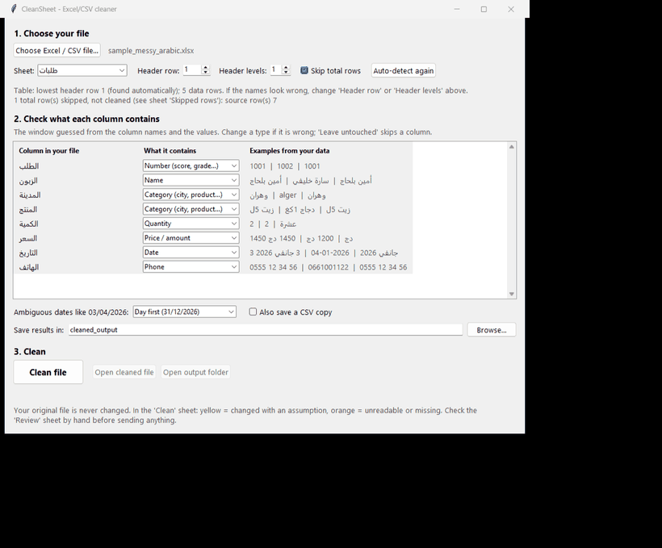

# CleanSheet (تنظيف الجداول)

<div dir="rtl">

أداة تنظّف ملفات Excel و CSV المليئة بالأخطاء: المسافات الزائدة، الكتابة غير المتسقة، الصفوف المكرّرة حرفيا، تنسيقات الأسعار والتواريخ المتضاربة، الأعداد المكتوبة بالحروف، الأرقام العربية (٠١٢٣)، وصيغ أرقام الهاتف حسب البلد.

بعد التنظيف تحصل على: الملف النظيف، وسجل بكل تعديل (قبل/بعد)، وقائمة بالقيم التي لم تستطع الأداة قراءتها.

الأداة تعمل بقواعد مكتوبة، وليست ذكاء اصطناعيا. لا تخمّن أبدا: كل قيمة غامضة تُعلَّم باللون الأصفر لتقرر أنت. الملف الأصلي لا يُعدّل أبدا، ولا شيء يُرسل إلى الإنترنت، كل شيء يحدث على جهازك.

مبنية للجداول الحقيقية: أعمدة بأسماء عربية أو فرنسية أو إنجليزية، جداول لا تبدأ من الخلية A1، عناوين من مستويين، صفوف "المجموع" في الأسفل، أسعار مثل `1 450 دج` أو `1 250 درهم`، تواريخ مثل `جانفي 2026` و`غشت 2026`.



## التحميل

أسرع طريقة (ويندوز، بدون بايثون): نزّل ملف zip من صفحة [Releases](https://github.com/aimenachraff-jpg/CleanSheet/releases/latest)، فك الضغط، وشغّل `CleanSheet.exe`. سيلفت انتباهك تنبيه SmartScreen لأن الملف غير موقّع: اضغط More info ثم Run anyway.

أو بالبايثون (أي نظام):

```
pip install cleansheet
cleansheet file.xlsx
cleansheet file.xlsx --locale ma
cleansheet-gui
```

## حسب البلد

قواعد الهاتف والعملة وأسماء الشهور تأتي من حزمة بلد تختارها بـ `--locale`:

| الحزمة | البلد | الأسعار |
|---|---|---|
| `dz` (الافتراضية) | الجزائر | `دج`، `دينار` |
| `ma` | المغرب | `درهم`، `DH` |
| `tn` | تونس | `د.ت`، `DT` |
| `eg` | مصر | `جنيه`، `LE` |
| `fr` | فرنسا | `€` |
| `generic` | أي بلد آخر | رموز شائعة فقط |

## ما تصلحه وما لا تصلحه

تصلحه تلقائيا (وكل تعديل مسجّل): المسافات والحالات، الكلمات العددية مثل "عشرة" و"dix"، صيغ الأسعار مثل `١٤٥٠ دج`، التواريخ الواضحة بأي شهر عربي أو فرنسي، أرقام الهاتف (+213، +212، +216، +20، +33)، الصفوف المكررة حرفيا، وأخطاء إملائية في عناوين الأعمدة.

تتركها لك: التواريخ الغامضة مثل `02/09/2026`، الأعداد الغامضة مثل `1,450`، القيم غير القابلة للقراءة (تبقى كما هي باللون البرتقالي)، والأسماء التي تختلف بالهمزة أو التشكيل فقط (أحمد / احمد): تُعلَّم للمراجعة ولا تُدمج أبدا.

## ملفات تجريبية

في المستودع ملفات وهمية جاهزة للتجربة: `sample_messy_arabic.xlsx` (عناوين عربية)، `sample_messy_moroccan.xlsx` (عناوين فرنسية بصيغ مغربية)، `sample_messy_sales.xlsx` (إنجليزية).

## توثيق إضافي

- [CONTRIBUTING.md](CONTRIBUTING.md) — كيف تساهم، أو تضيف حزمة بلد، أو تبلغ عن مشكلة في ملف
- [CHANGELOG.md](CHANGELOG.md) — تاريخ الإصدارات
- [PRIVACY.md](PRIVACY.md) — العمل دون إنترنت، البيانات لا تغادر جهازك، لا استخبارات ولا سحابة
- [SECURITY.md](SECURITY.md) — سياسة التبعيات ومعالجة البيانات
- [ROADMAP.md](ROADMAP.md) — ما مخطط له وما خارج النطاق

## الترخيص

MIT. انظر [LICENSE](LICENSE). لو أفسدت الأداة أحد ملفاتك، افتح مشكلة (issue) مع نموذج وهمي من الملف — وجود مساهمين مرحّب بهم، انظر [CONTRIBUTING.md](CONTRIBUTING.md).

</div>
