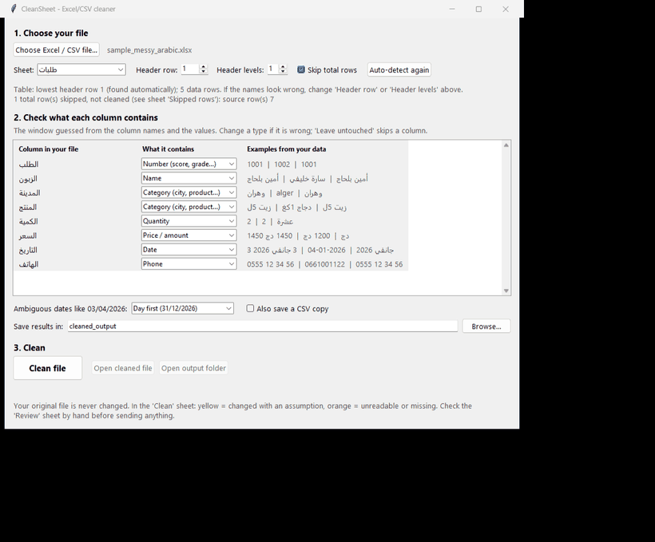

# CleanSheet

Nettoie les fichiers Excel et CSV désordonnés : espaces en trop, majuscules incohérentes, doublons exacts, formats de prix et de dates mélangés, nombres écrits en lettres, chiffres arabes (٠١٢٣), formats de téléphone par pays.

Vous obtenez le fichier nettoyé, un journal de chaque modification (avant/après), et la liste des valeurs que l'outil n'a pas su lire.

C'est du code à base de règles, pas de l'IA. L'outil ne devine jamais : toute valeur ambiguë est marquée en jaune, la décision vous revient. Le fichier original n'est jamais modifié, et rien ne quitte votre ordinateur.

Pensé pour les vrais fichiers de vente : colonnes en français, anglais ou arabe, tableaux qui ne commencent pas en A1, en-têtes sur deux niveaux, lignes « Total » en bas, prix comme `1 450 DA`, `1 250 DH` ou `دج`, dates comme `جانفي 2026` ou `غشت 2026`.



## Démarrage rapide

Windows sans Python : téléchargez le zip sur la page [Releases](https://github.com/aimenachraff-jpg/CleanSheet/releases/latest), décompressez, lancez `CleanSheet.exe`. Windows affichera un avertissement SmartScreen car l'exe n'est pas signé : More info, puis Run anyway.

Avec Python (tous systèmes) :

```
pip install cleansheet
cleansheet fichier.xlsx
cleansheet fichier.xlsx --locale ma
cleansheet-gui
```

## Packs pays

Les règles de téléphone, les mots de devise et les noms de mois viennent d'un pack choisi avec `--locale` :

| Pack | Pays | Prix lus |
|---|---|---|
| `dz` (défaut) | Algérie | `1 450 DA`, `دج`, `دينار` |
| `ma` | Maroc | `1 250 DH`, `درهم`, `MAD` |
| `tn` | Tunisie | `12,5 DT`, `د.ت` |
| `eg` | Égypte | `1,250 LE`, `جنيه` |
| `fr` | France | `1 250 €` |
| `generic` | autre | symboles courants |

## Ce qu'il corrige et ce qu'il ne corrige pas

Corrigé automatiquement (chaque modification est journalisée) : espaces et majuscules, mots-nombres (« dix », « ثلاثة »), formats de prix comme `1 450 DA`, dates claires avec mois arabes ou français, téléphones (+213, +212, +216, +20, +33), doublons exacts, fautes dans les en-têtes (« mongtant » → la colonne montant).

Laisssé à votre décision : dates ambiguës comme `02/09/2026`, nombres ambiguës comme `1,450`, valeurs illisibles (conservées telles quelles, en orange), noms qui ne diffèrent que par la hamza ou les diacritiques (أحمد / احمد) : signalés, jamais fusionnés.

## Exemples

Le dépôt contient des fichiers fictifs pour essayer : `sample_messy_arabic.xlsx` (en-têtes arabes), `sample_messy_moroccan.xlsx` (en-têtes français, formats marocains), `sample_messy_sales.xlsx` (anglais).

## Documentation complémentaire

- [CONTRIBUTING.md](CONTRIBUTING.md) — comment contribuer, ajouter un pays, signaler un fichier problématique
- [CHANGELOG.md](CHANGELOG.md) — historique des versions
- [PRIVACY.md](PRIVACY.md) — hors ligne, local uniquement ; aucune télémétrie ni cloud
- [SECURITY.md](SECURITY.md) — politique de dépendances et traitement des données
- [ROADMAP.md](ROADMAP.md) — travaux prévus et hors périmètre

## Licence

MIT. Voir [LICENSE](LICENSE). Si l'outil gère mal un de vos fichiers, ouvrez une issue avec un échantillon fictif. Les contributions sont bienvenues : [CONTRIBUTING.md](CONTRIBUTING.md).
