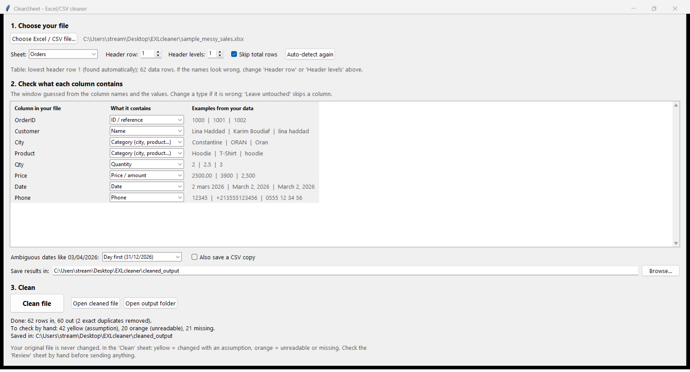

# CleanSheet

[](https://github.com/aimenachraff-jpg/CleanSheet/actions/workflows/tests.yml)
[](https://pypi.org/project/cleansheet/)

Cleans messy Excel and CSV files: extra spaces, inconsistent capitalization, exact duplicates, mixed price and date formats, numbers written as words, Arabic-Indic digits, country phone formats. You get the cleaned file, a log of every change, and a list of the values the tool could not decide on.

It is rule-based code, not AI. It never guesses: anything ambiguous is flagged in the output for you to decide. Your original file is never modified, and nothing leaves your computer.

Built with real sales data in mind: columns named in French, English or Arabic, files where the table does not start at A1, two-level headers, "Total" rows at the bottom, prices like `1 450 DA`, `1 250 DH` or `دج`, dates like `جانفي 2026` or `غشت 2026`.



<!-- Demo GIF (10-15s, messy file -> Clean -> yellow/orange review cells) goes here. -->

## Quick start

```
# Windows, no Python needed: download the exe from Releases, extract, run CleanSheet.exe
# Python, any OS:
pip install cleansheet
cleansheet file.xlsx            # cleans file.xlsx, writes file_cleaned.xlsx
cleansheet file.xlsx --locale ma
cleansheet-gui                  # windowed app
```

More in [README.ar.md](README.ar.md) (العربية) and [README.fr.md](README.fr.md) (français).

## How it works

1. Open the app and pick a `.xlsx` or `.csv` file.
2. The tool finds the table (even below title rows or notes), guesses each column's type from its header, and shows you the guess to confirm or fix.
3. Click Clean. You get a new workbook in a `cleaned_output` folder next to your file, with five sheets:

| Sheet | What it holds |
|---|---|
| Clean | The cleaned data. Yellow = changed with an assumption, check it. Orange = unreadable or missing, original kept. |
| Review | Every yellow and orange cell with a note. Go through it before you use the file. |
| Change log | Every change, before and after. |
| Before-After | First 20 rows side by side. |
| Summary | Counts, plus the rules that were applied. |


Rows that look like totals ("Total", "Somme", "المجموع") are not cleaned as data; they are copied to a Skipped rows sheet. You can keep them in with one checkbox.

## Why not just use pandas, OpenRefine or Excel?

- **It runs offline and needs no skills.** A shop manager or accountant double-clicks the exe. pandas needs Python, a terminal and a script per file layout.
- **It never guesses.** pandas and Excel fix-converts silently: `02/09/2026` becomes September 2 without telling you. CleanSheet marks every assumption in yellow and leaves the call to you.
- **It knows the formats the big tools ignore.** `1 450 DA`, `1.250,50 درهم`, جانفي and غشت month names, `٠١٢٣` digits, 8-digit Tunisian phones. Out of the box, with a change log.

## What it fixes and what it does not

Fixed automatically (each one logged):

- Extra spaces, upper/lower case of the same name or city
- Number words like "dix" or "ثلاثة", price formats like `1 450 DA` or `1 250 DH`
- Clear dates like `3 septembre 2026` or `2026-09-03`; Arabic month names (Maghrebi, standard, Levantine) are understood
- Phone formats (+213, +212, +216, +20, +33), Arabic-Indic (٠١٢٣) and Persian (۰۱۲۳) digits
- Exact duplicate rows
- Typos in headers ("mongtant" → the montant column), two-level headers joined as `Produit1 - Qté`

Flagged for you, never decided for you:

- Ambiguous dates like `02/09/2026` (day-first or month-first; you pick the default, the tool marks them)
- Ambiguous numbers like `1,450` (1.45 or 1450)
- Unreadable or missing values: kept as they were, never filled in
- Names that differ only by hamza or diacritics (أحمد / احمد): flagged for review, never merged
- Synonyms across languages ("Thon" and "Tuna"): not merged, not flagged. Real synonyms need a human.

## Locale packs

Phone rules, currency words and month names come from a country pack, chosen with `--locale`:

| Locale | Country | Phones | Prices read |
|---|---|---|---|
| `dz` (default) | Algeria | +213, 9 digits | `1 450 DA`, `دج`, `دينار` |
| `ma` | Morocco | +212, 9 digits | `1 250 DH`, `درهم`, `MAD` |
| `tn` | Tunisia | +216, 8 digits, no leading 0 | `12,5 DT`, `د.ت` |
| `eg` | Egypt | +20, 10 digits | `1,250 LE`, `جنيه` |
| `fr` | France | +33, 9 digits | `1 250 €` |
| `generic` | anywhere | length check only | common currency symbols |

The default is `dz` (where the project started). See [CONTRIBUTING.md](CONTRIBUTING.md) to add a country; the pack file is a few lines. Sample files: `sample_messy_arabic.xlsx` (Arabic headers, Algerian formats), `sample_messy_moroccan.xlsx` (French headers, Moroccan formats), `sample_messy_sales.xlsx` (English).

## Getting it running

The easiest way, no Python needed: download [CleanSheet-1.0.0-windows.zip](https://github.com/aimenachraff-jpg/CleanSheet/releases/latest) from the Releases page, extract it, and run `CleanSheet.exe` from the extracted `CleanSheet` folder (Windows 10 or 11, 64-bit). Windows will show a SmartScreen warning because the exe is not signed; click More info, then Run anyway.

From Python:

```
pip install cleansheet
```

Command line:

```
cleansheet client.xlsx --out-dir out/
# or from source: python clean_sheet.py client.xlsx
```

Windowed app (pick the file, confirm the column types, click Clean):

```
cleansheet-gui
# or from source: python clean_sheet_gui.py
```

On Windows you can just double-click `start_CleanSheet.bat`.

### Building a standalone .exe

Double-click `build_exe.bat` (it downloads PyInstaller once). The result is `dist\CleanSheet\CleanSheet.exe`; keep the whole `CleanSheet` folder together and make a shortcut to the exe. Windows will show a SmartScreen warning for an unsigned exe you built yourself; that is expected.

### Column types

`clean_sheet.py` guesses column types from the header and, when the name gives no clue, from the values (phone, date, email, price with DA/دج/DH, plain numbers). To override the guess:

```
python clean_sheet.py client.xlsx --write-config client.json
```

Edit `client.json` (types: `id`, `name`, `category`, `qty`, `price`, `date`, `phone`, `email`, `text`, `skip`), then rerun with `--config client.json`. Two example configs are in the repo: `config_sales_demo.json` and `config_client_style.json` (French headers). Other options: `--sheet NAME`, `--header-row N`, `--levels 1`, `--keep-total-rows`, `--also-csv`. A `--config` file always wins over the locale pack.

## Limitations

- Reads the first table on the chosen sheet only.
- No scans or PDFs, no formulas or dashboards, no merging files with different layouts.
- It does not invent values: what it cannot read stays unreadable, in orange.
- Tested on synthetic files. If it mishandles your file, please open an issue with a sample.

## Tests

```
python test_clean_sheet.py
python test_table_detection.py
python test_multilevel.py
python test_gui_logic.py
python test_locale_packs.py
```

57 tests cover the cleaning rules, table and header detection, the GUI logic, and the locale packs.

## License

MIT. See [LICENSE](LICENSE).
