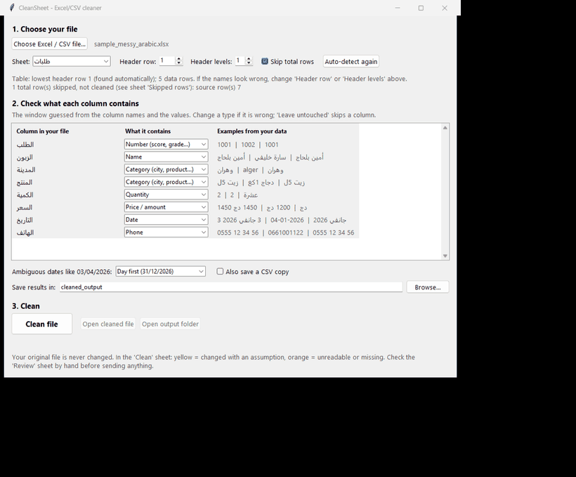
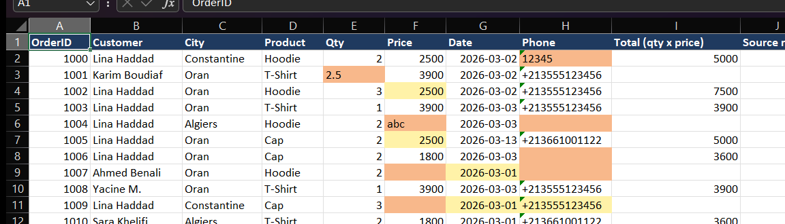

# CleanSheet


[](https://github.com/aimenachraff-jpg/CleanSheet/actions/workflows/tests.yml)
[](https://pypi.org/project/cleansheet/)
[](LICENSE)
[](https://www.python.org/)
[](https://github.com/aimenachraff-jpg/CleanSheet/releases/latest)



**CleanSheet cleans messy Excel and CSV files offline.** It fixes extra spaces, inconsistent casing, exact duplicates, mixed price and date formats, numbers written as words, Arabic-Indic digits, and country phone formats. You get the cleaned file, a change log of every edit, and a list of the values the tool could not decide on — flagged for you, never guessed.

It is rule-based code, not AI. Anything ambiguous is highlighted for your decision. Your original file is never modified, and nothing leaves your computer.

[中文] [العربية] [français]

---

## What it cleans

| Problem | How CleanSheet handles it |
|---|---|
| Extra spaces, inconsistent casing | Normalized; every change logged |
| Exact duplicate rows | Removed (customizable via `dedup_keys`) |
| Mixed price formats | `1 450 DA`, `1 250 DH`, `دج`, `12,5 DT`, `جنيه`, … |
| Numbers written as words | `dix`, `ثلاثة`, `cinq` → digits |
| Arabic-Indic / Persian digits | `٠١٢٣`, `۰۱۲۳` → `0123` |
| Mixed date formats | `3 septembre 2026`, `2026-09-03`, جانفي, غشت |
| Phone numbers | +213, +212, +216, +20, +33 — per country pack |
| Ambiguous values | Flagged yellow/orange for you to decide, never guessed |
| Two-level headers | Joined as `Produit1 - Qté` |
| "Total" rows | Copied to a Skipped rows sheet (optional) |

## Supported locales

Phone rules, currency words, and month names come from a country pack chosen with `--locale`:

| Locale | Country | Phones | Prices read |
|---|---|---|---|
| `dz` (default) | Algeria | +213, 9 digits | `1 450 DA`, `دج`, `دينار` |
| `ma` | Morocco | +212, 9 digits | `1 250 DH`, `درهم`, `MAD` |
| `tn` | Tunisia | +216, 8 digits, no leading 0 | `12,5 DT`, `د.ت` |
| `eg` | Egypt | +20, 10 digits | `1,250 LE`, `جنيه` |
| `fr` | France | +33, 9 digits | `1 250 €` |
| `generic` | anywhere | length check only | common currency symbols |

More in [README.ar.md](README.ar.md) (العربية) and [README.fr.md](README.fr.md) (français).

---

## What you get

Running CleanSheet on a file produces a cleaned workbook with five sheets:

| Sheet | What it holds |
|---|---|
| **Clean** | The cleaned data. Yellow = changed with an assumption, check it. Orange = unreadable or missing, original kept. |
| **Review** | Every yellow and orange cell with a note. Go through it before you use the file. |
| **Change log** | Every change, before and after. |
| **Before-After** | First 20 rows side by side. |
| **Summary** | Counts, plus the rules that were applied. |



---

## Installation

### Windows, no Python needed

Download [CleanSheet-1.0.0-windows.zip](https://github.com/aimenachraff-jpg/CleanSheet/releases/latest) from the [Releases page](https://github.com/aimenachraff-jpg/CleanSheet/releases), extract it, and run `CleanSheet.exe` from the extracted `CleanSheet` folder (Windows 10 or 11, 64-bit). Windows will show a SmartScreen warning because the exe is not signed; click **More info**, then **Run anyway**.

### From Python (any OS)

```
pip install cleansheet==1.2.0
# or upgrade an existing install:
pip install --upgrade cleansheet
```

This installs two commands:

```
cleansheet file.xlsx            # command-line cleaner
cleansheet-gui                  # windowed app
```

Or from source:

```
git clone https://github.com/aimenachraff-jpg/CleanSheet.git
cd CleanSheet
pip install openpyxl
python clean_sheet.py file.xlsx      # CLI
python clean_sheet_gui.py            # GUI
```

openpyxl is the only runtime dependency; everything else is Python standard library. `requires-python >= 3.8`.

---

## Quick start

### Command line

```
cleansheet client.xlsx                      # writes client_cleaned.xlsx
cleansheet client.xlsx --locale ma          # Moroccan phone/price rules
cleansheet client.xlsx --out-dir out/       # put output in out/
cleansheet client.xlsx --dry-run            # report what would change, no output file
cleansheet client.xlsx --export-log         # also write client_audit.csv change log
cleansheet file1.xlsx file2.xlsx --locale dz   # batch: clean multiple files
cleansheet client.xlsx --force              # overwrite an existing *_cleaned.xlsx
cleansheet client.xlsx --write-config cfg.json  # save detected column mapping to edit
cleansheet client.xlsx --config cfg.json  # use your saved column mapping
```

### Windowed app

```
cleansheet-gui
# or from source:
python clean_sheet_gui.py
```

Pick a file, confirm the column types the tool guesses, click Clean. On Windows you can also double-click `start_CleanSheet.bat`.

---

## How it works

1. **Pick a `.xlsx` or `.csv` file.** The GUI shows it; the CLI takes it as an argument.
2. **The tool finds the table** — even if it starts below title rows or notes. It guesses each column's type from its header (phone, date, email, price with DA/دج/DH, plain number, text, skip) and shows you the guess to confirm or fix.
3. **Click Clean.** CleanSheet writes a new workbook next to your file with the five sheets above. Yellow cells are changes to review; orange cells are values it could not read, kept as-is.
4. **Review before you use it.** The Review sheet lists every flagged cell with a note. Nothing is silently filled in.

---

## Python API

CleanSheet exposes a small function-based API (no classes required):

```python
from clean_sheet import run

result = run(
    "client.xlsx",
    locale="ma",        # country pack (default "dz")
    out_dir="out/",     # where to write output
    dry_run=False,      # set True to report changes without writing
    export_log=True,    # write a *_audit.csv change log next to output
    force=False,        # set True to overwrite an existing *_cleaned.xlsx
)
print(result["rows_in"], "rows in ->", result["rows_out"], "rows out")
print(result["log"])    # every change, before/after/status/note
```

`run()` returns a dict with `xlsx`, `report`, `rows_in`, `rows_out`, `removed`, `log`, `cells`, `keep`, `headers`, `cfg`, and `info`. The original input file is never modified.

Lower-level: `clean_table(headers, rows, cfg)` cleans an already-parsed table and returns the same result shape, useful if you want to pre-process rows yourself.

The CLI entry point is `clean_sheet.main(argv=None)`; the GUI entry point is `clean_sheet_gui.main()`.

---

## Example: before → after

The repo includes fictional sample files so you can try it without your own data:

- `sample_messy_sales.xlsx` — English headers, mixed formats
- `sample_messy_arabic.xlsx` — Arabic headers, Algerian formats
- `sample_messy_moroccan.xlsx` — French headers, Moroccan formats

Each has a matching `*_cleaned.xlsx` showing the expected output. Run:

```
cleansheet sample_messy_sales.xlsx --locale dz --out-dir try/
```

then open `try/sample_messy_sales_cleaned.xlsx` and check the **Review** sheet.

---

## What it does not do

- Reads only the first table on the chosen sheet.
- No scans or PDFs, no formulas or dashboards, no merging files with different layouts.
- It does not invent values: what it cannot read stays unreadable, in orange.
- Excel `.xlsm` macros are not preserved by the Excel library; macro files are flagged rather than silently stripped.
- Tested on synthetic (fictional) files. If it mishandles your file, open an issue with a fictional sample (see CONTRIBUTING.md).

---

## Privacy & offline processing

CleanSheet runs entirely on your computer. No telemetry, no cloud, no accounts, no paid service. Nothing is uploaded. See [PRIVACY.md](PRIVACY.md) and [SECURITY.md](SECURITY.md).

---

## Contributing

Bug reports, locale packs, and new column types are welcome. Every change gets a test, and the suite runs on every push.

- [CONTRIBUTING.md](CONTRIBUTING.md) — how to contribute, add a country locale, or report a broken file
- `.github/ISSUE_TEMPLATE/file_broke_it.yml` — use this template when a file is cleaned incorrectly

Keep the README honest: if you add a flag or a locale, document it in the same plain style.

---

## Documentation

- [CHANGELOG.md](CHANGELOG.md) — release history
- [CONTRIBUTING.md](CONTRIBUTING.md) — how to contribute
- [PRIVACY.md](PRIVACY.md) — offline, local-only data handling
- [SECURITY.md](SECURITY.md) — dependency policy and data handling
- [ROADMAP.md](ROADMAP.md) — planned and out-of-scope work
- [README.ar.md](README.ar.md) — Arabic
- [README.fr.md](README.fr.md) — French

---

## Tests

```
python test_clean_sheet.py
python test_table_detection.py
python test_multilevel.py
python test_gui_logic.py
python test_locale_packs.py
python test_csv_encoding.py
python test_gui_locale.py
python test_gui_thread.py
python test_reliability.py
```

88 tests across 9 files cover the cleaning rules, table and header detection, GUI logic, locale packs, CSV encoding edge cases, GUI locale/threading, and reliability (original-file-untouched, reproducibility, large files, batch, dry-run, audit log, dedup keys). All run in CI on every push.

---

## License

MIT. See [LICENSE](LICENSE).

---

*Built with real sales data in mind: columns named in French, English or Arabic, prices like `1 450 DA` or `1 250 DH`, dates like `جانفي 2026` or `غشت 2026`. Rule-based, offline, and honest about what it cannot decide.*
